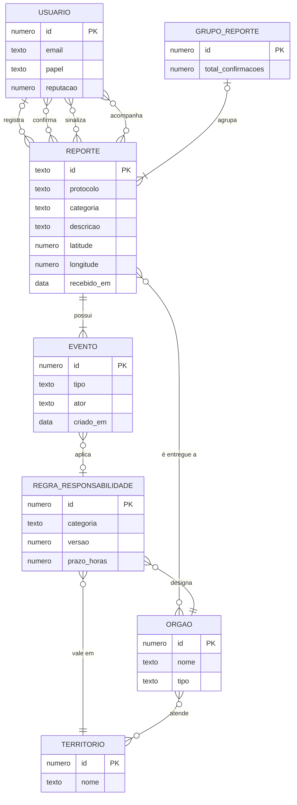
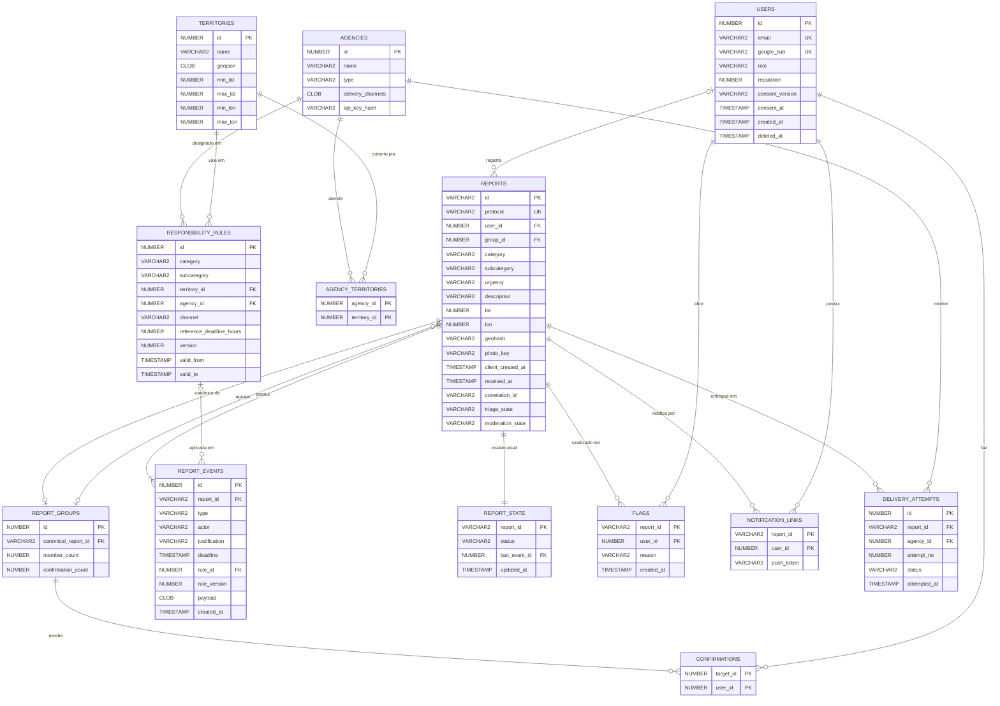

# Diagramas de Dados — App de Reportes Cidadãos

Complementa `02-especificacao-tecnica.md` (§3, modelo de dados) e o documento de Regras Técnicas (RT-xx). Os diagramas usam Mermaid (`erDiagram`) e renderizam em GitHub, GitLab, VS Code (extensão Markdown Preview Mermaid) e no site mermaid.live.

- **MER** (modelo entidade-relacionamento): visão conceitual, só com entidades, atributos principais e cardinalidades.
- **DER** (diagrama entidade-relacionamento): visão lógica das tabelas do Oracle, com chaves primárias (PK), estrangeiras (FK) e únicas (UK).

## 1. MER (modelo conceitual)

O status do reporte não é uma entidade: ele é derivado dos eventos (RT-05, RT-21).

### Relacionamentos

| Relacionamento | Cardinalidade |
| :-- | :-- |
| Usuário registra Reporte | 1 usuário para N reportes; o reporte anônimo não tem usuário (RT-48) |
| Usuário confirma Reporte | N para N (uma confirmação por usuário) |
| Usuário sinaliza Reporte | N para N (sinalização de abuso, RN-35) |
| Usuário acompanha Reporte | N para N (vínculo de notificação, RT-22) |
| Reporte possui Evento | 1 para N, com pelo menos o evento `recebido` |
| Grupo de reportes agrupa Reporte | 1 para N; o reporte pode não ter grupo (RT-37) |
| Reporte é entregue a Órgão | N para N, registrado em cada tentativa de entrega (RT-38) |
| Evento aplica Regra de responsabilidade | N para 1 opcional; só o evento `encaminhado` aponta a regra (RT-35) |
| Regra de responsabilidade designa Órgão | N para 1 |
| Regra de responsabilidade vale em Território | N para 1 |
| Órgão atende Território | N para N |

## 2. DER (modelo lógico, Oracle)

### Chaves por tabela

| Tabela | Chave primária | Chaves estrangeiras e únicas |
| :-- | :-- | :-- |
| `users` | `id` | UK: `email`, `google_sub` |
| `reports` | `id` (UUID do cliente) | FK: `user_id` para `users`, `group_id` para `report_groups`; UK: `protocol` |
| `report_state` | `report_id` | FK: `report_id` para `reports`, `last_event_id` para `report_events` |
| `report_events` | `id` | FK: `report_id` para `reports`, `rule_id` para `responsibility_rules` |
| `report_groups` | `id` | FK: `canonical_report_id` para `reports` |
| `confirmations` | (`target_id`, `user_id`) | FK: `target_id` para `report_groups`, `user_id` para `users` |
| `flags` | (`report_id`, `user_id`) | FK: `report_id` para `reports`, `user_id` para `users` |
| `notification_links` | (`report_id`, `user_id`) | FK: `report_id` para `reports`, `user_id` para `users` |
| `agencies` | `id` | — |
| `territories` | `id` | — |
| `agency_territories` | (`agency_id`, `territory_id`) | FK: `agency_id` para `agencies`, `territory_id` para `territories` |
| `responsibility_rules` | `id` | FK: `agency_id` para `agencies`, `territory_id` para `territories` |
| `delivery_attempts` | `id` | FK: `report_id` para `reports`, `agency_id` para `agencies` |

### Correspondência MER e DER

| MER (conceitual) | DER (lógico) |
| :-- | :-- |
| Usuário | `users` |
| Reporte | `reports` e `report_state` (status atual, derivado dos eventos) |
| Evento | `report_events` |
| Grupo de reportes | `report_groups` |
| Órgão | `agencies` |
| Território | `territories` |
| Regra de responsabilidade | `responsibility_rules` |
| confirma, sinaliza, acompanha | `confirmations`, `flags`, `notification_links` |
| é entregue a | `delivery_attempts` |
| atende | `agency_territories` |

## 3. Observações

- **Fora do diagrama:** as tabelas de apoio técnico `refresh_tokens`, `otp_challenges`, `audit_log`, `job_queue`, `ai_cache` e `app_config` não aparecem, para manter o DER legível. Elas estão descritas em `02-especificacao-tecnica.md` §3.1 e §3.2.
- **Imutabilidade (RT-21):** `reports` e `report_events` não aceitam `UPDATE` nem `DELETE` de conteúdo (gatilhos que levantam `ORA-20100`). O que muda fica em `report_state`, atualizada só pelo pacote `PKG_EVENTOS`.
- **Anonimato (RT-22, RT-48):** `reports.user_id` é nulo em reporte anônimo. O vínculo de notificação fica em `notification_links`, separado do conteúdo, e é apagado junto com a conta.
- **Particionamento (RT-84):** `report_events` é particionada por mês em `created_at`.
- **Confirmações:** em `confirmations`, `target_id` referencia o grupo do reporte (uma confirmação por usuário por grupo, RT-37).
