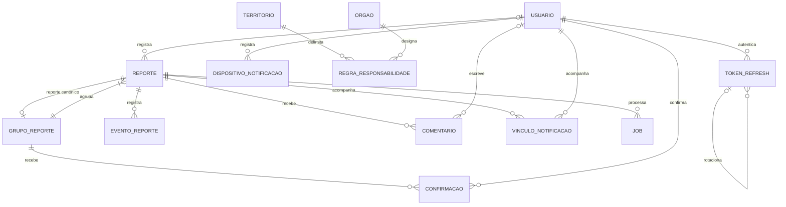

# MER e DER — modelo de dados Oracle

**Fonte:** estado consolidado de [`schema.sql`](../back-end/db/schema.sql) após
as migrações V002–V005. O DDL pronto para importar no Oracle SQL Developer Data
Modeler está em
[`oracle_data_modeler_ddl.sql`](../back-end/db/oracle_data_modeler_ddl.sql).

Os diagramas abaixo foram alinhados às tabelas, chaves e relações declaradas
nesses arquivos. Os nomes de tabelas e colunas permanecem em inglês conforme o
DDL.

## 1. MER — modelo conceitual



O status atual não tem tabela própria: é derivado dos eventos de
`report_events`. Sinalizações, encaminhamentos, mudanças de status e ações de
moderação também são registradas como eventos. Não há tabela independente de
entregas, sinalizações ou estado atual no DDL vigente.

## 2. DER — modelo lógico Oracle

```mermaid
erDiagram
  USERS o|--o{ REPORTS : "user_id"
  REPORT_GROUPS ||--|{ REPORTS : "group_id"
  REPORTS ||--o| REPORT_GROUPS : "canonical_report_id"
  REPORTS ||--o{ REPORT_EVENTS : "report_id"
  REPORTS ||--o{ REPORT_COMMENTS : "report_id"
  USERS o|--o{ REPORT_COMMENTS : "user_id"
  REPORT_GROUPS ||--o{ CONFIRMATIONS : "target_id"
  USERS ||--o{ CONFIRMATIONS : "user_id"
  REPORTS ||--o{ NOTIFICATION_LINKS : "report_id"
  USERS ||--o{ NOTIFICATION_LINKS : "user_id"
  USERS ||--o{ NOTIFICATION_DEVICES : "user_id"
  REPORTS ||--o{ JOB_QUEUE : "report_id"
  TERRITORIES ||--o{ REPORTS : "territory_id"
  TERRITORIES ||--o{ RESPONSIBILITY_RULES : "territory_id"
  AGENCIES ||--o{ RESPONSIBILITY_RULES : "agency_id"
  USERS ||--o{ REFRESH_TOKENS : "user_id"
  REFRESH_TOKENS o|--o{ REFRESH_TOKENS : "rotated_from"

  USERS {
    NUMBER id PK
    VARCHAR2 email UK
    VARCHAR2 google_sub UK
    VARCHAR2 role
    NUMBER reputation
    VARCHAR2 consent_version
    TIMESTAMP consent_at
    TIMESTAMP created_at
    TIMESTAMP deleted_at
  }
  REPORTS {
    VARCHAR2 id PK
    VARCHAR2 protocol UK
    NUMBER user_id FK
    NUMBER group_id FK
    VARCHAR2 territory_id FK
    VARCHAR2 category
    VARCHAR2 description
    NUMBER lat
    NUMBER lon
    VARCHAR2 geohash
    VARCHAR2 photo_key
    TIMESTAMP client_created_at
    TIMESTAMP received_at
    VARCHAR2 correlation_id
    NUMBER has_photo
    VARCHAR2 triage_state
  }
  REPORT_GROUPS {
    NUMBER id PK
    VARCHAR2 canonical_report_id FK_UK
    NUMBER member_count
    NUMBER confirmation_count
  }
  REPORT_EVENTS {
    NUMBER id PK
    VARCHAR2 report_id FK
    VARCHAR2 type
    VARCHAR2 actor
    VARCHAR2 justification
    TIMESTAMP deadline
    CLOB payload
    TIMESTAMP created_at
  }
  REPORT_COMMENTS {
    NUMBER id PK
    VARCHAR2 report_id FK
    NUMBER user_id FK
    VARCHAR2 content
    TIMESTAMP created_at
  }
  CONFIRMATIONS {
    NUMBER target_id PK_FK
    NUMBER user_id PK_FK
    TIMESTAMP created_at
  }
  NOTIFICATION_LINKS {
    VARCHAR2 report_id PK_FK
    NUMBER user_id PK_FK
    VARCHAR2 push_token
  }
  NOTIFICATION_DEVICES {
    VARCHAR2 push_token PK
    NUMBER user_id FK
    VARCHAR2 platform
    TIMESTAMP created_at
    TIMESTAMP updated_at
  }
  JOB_QUEUE {
    NUMBER id PK
    VARCHAR2 report_id FK
    VARCHAR2 etapa
    VARCHAR2 status
    NUMBER attempts
    TIMESTAMP next_run_at
    TIMESTAMP created_at
    VARCHAR2 locked_by
    TIMESTAMP lease_until
    VARCHAR2 last_error
  }
  TERRITORIES {
    VARCHAR2 territory_id PK
    VARCHAR2 name
    NUMBER active
  }
  AGENCIES {
    VARCHAR2 agency_id PK
    VARCHAR2 name
    VARCHAR2 contact_email
    NUMBER active
  }
  RESPONSIBILITY_RULES {
    VARCHAR2 rule_id PK
    NUMBER version PK
    VARCHAR2 territory_id FK
    VARCHAR2 category
    VARCHAR2 subcategory
    VARCHAR2 agency_id FK
    NUMBER deadline_hours
    TIMESTAMP valid_from
    TIMESTAMP valid_to
    NUMBER active
  }
  OTP_CHALLENGES {
    VARCHAR2 email PK
    VARCHAR2 code_hash
    TIMESTAMP expires_at
    NUMBER attempts
    VARCHAR2 consent_version
    TIMESTAMP created_at
  }
  REFRESH_TOKENS {
    VARCHAR2 token_hash PK
    NUMBER user_id FK
    TIMESTAMP expires_at
    VARCHAR2 rotated_from FK
    TIMESTAMP revoked_at
    TIMESTAMP created_at
  }
  AUDIT_LOG {
    NUMBER id PK
    NUMBER actor_user_id
    VARCHAR2 action
    VARCHAR2 resource_type
    VARCHAR2 resource_id
    VARCHAR2 justification
    VARCHAR2 correlation_id
    TIMESTAMP created_at
  }
```

`REPORT_GROUPS.canonical_report_id` é único e referencia `REPORTS.id` com
constraint deferida; `REPORTS.group_id` é obrigatório. A referência cíclica
permite criar o grupo canônico e o reporte na mesma transação.

## 3. Tabelas e chaves

| Tabela | Chave primária | Relações e unicidade |
|---|---|---|
| `users` | `id` | `email` e `google_sub` únicos |
| `reports` | `id` | FKs para `users`, `report_groups` e `territories`; `protocol` único |
| `report_groups` | `id` | `canonical_report_id` FK para `reports`, único |
| `report_events` | `id` | FK para `reports` |
| `report_comments` | `id` | FK para `reports`; FK opcional para `users` no estado pós-V005 |
| `confirmations` | (`target_id`, `user_id`) | FKs para grupo de reporte e usuário |
| `notification_links` | (`report_id`, `user_id`) | FKs para reporte e usuário |
| `notification_devices` | `push_token` | FK para usuário |
| `job_queue` | `id` | FK para reporte; (`report_id`, `etapa`) único |
| `territories` | `territory_id` | — |
| `agencies` | `agency_id` | — |
| `responsibility_rules` | (`rule_id`, `version`) | FKs para território e órgão |
| `otp_challenges` | `email` | Não há FK declarada para `users` |
| `refresh_tokens` | `token_hash` | FK para usuário e autorreferência opcional em `rotated_from` |
| `audit_log` | `id` | `actor_user_id` não tem FK declarada |

## 4. Migrations e objetos fora do MER/DER

- V002 amplia leases e estados da fila `job_queue`.
- V003 cria `notification_devices`.
- V004 cria `audit_log`.
- V005 permite anonimizar o autor de comentários (`user_id` nulo) e troca o
  gatilho de imutabilidade de `reports` por um que permite somente a operação de
  anonimização definida na migration.
- Packages PL/SQL, triggers, índices, scheduler e dados de seed não são
  entidades do MER. Permanecem no DDL e scripts de operação correspondentes.
- O DDL do Data Modeler representa as tabelas consolidadas após as migrations;
  para instalação/upgrade, usar `schema.sql` e a sequência de migrations, não
  executar o DDL de modelagem como migration.
