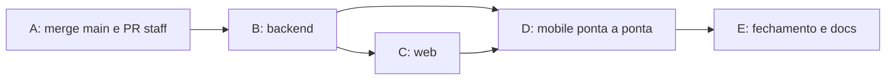

# Plano de fechamento da entrega

**Atualizado em:** 18/11/2026
**Branch de referência:** `feature/backend-staff-api`

Este plano substitui o plano de 5 itens anterior. "100%" significa fechar o que
a entrega precisa mostrar funcionando, não tudo o que o
[`08-pendencias-por-camada.md`](./08-pendencias-por-camada.md) registra. O
restante vira trabalho futuro documentado.

**Prioridade congelada:** login, novo reporte, classificação por IA,
direcionamento ao órgão responsável, gestão do reporte/ocorrência e a parte
analítica, com backend integrado ao mobile e ao web. Testes, CI e CD ficam no
mínimo: um smoke manual por etapa e o `pytest` que já existe.

## 1. Situação verificada no repositório

| Item | Estado |
|---|---|
| Itens 1 a 4 do plano antigo (CI, Docker, nearby, mapa/feed, Android, triagem, duplicados) | Mergeados na `origin/main` (PRs #1 a #8) |
| Branch `feature/backend-staff-api` | 8 commits à frente da `main`; **não** contém os PRs #5 a #8 |
| Login institucional **por OTP** | Pronto no backend e no web (`auth.service`, guard, interceptor, refresh) |
| Rotas `/v1/staff/*` | Prontas: `me`, `agencies`, `summary`, lista, detalhe e `status` (só papel `agency`) |
| Web `/indicadores` | Ligada a `GET /v1/public/metrics` |
| Web `dashboard`, `occurrences`, `occurrence-detail` | Ainda com dados demonstrativos |
| Moderação | Só a listagem (`GET /v1/moderation/reports`); não há aprovar/rejeitar |
| Mudança de status | Existe por Bearer (`/v1/staff/...`) e por `X-API-Key` (`/v1/agency/...`) |
| Redirecionar a outro órgão | Não existe rota |
| Série temporal e analítica por categoria/bairro | Não existe |
| Classificador | `CLASSIFIER` aceita `null`, `fake` e `ollama`; o padrão é `null` |
| Branch `feat/staff-auth` (senha + TOTP) | **Não está no local nem no `origin`**: não foi possível conferir |

## 2. Decisões

1. **Login da entrega = OTP institucional que já existe.** Senha, TOTP, convite,
   sessão no servidor, gestão de usuários com hierarquia, `V008`/`pkg_staff` e
   bootstrap do admin ficam como trabalho futuro (seção 8), salvo se o código já
   estiver pronto na branch do colega.
2. **Classificador para a demonstração:** `ollama`, com `fake` como alternativa
   se o modelo não estiver disponível. *Confirmar com a equipe.*
3. **Detalhe do reporte:** o servidor lê pelo `/v1/staff/reports/{id}`; o cidadão
   continua só no próprio reporte. *Confirmar com a equipe.*

## 3. Fase A: base

- [ ] A1. Fazer merge de `origin/main` em `feature/backend-staff-api` e resolver
  conflitos.
- [ ] A2. Rodar o `pytest` do backend e o build do web.
- [ ] A3. Abrir a PR (backend staff + login web) e mergear na `main`.
- [ ] A4. Combinar com o colega quem mexe em `auth_service` e `staff.py`, para
  evitar conflito, e rebasear o trabalho dele depois, se for aproveitado.

## 4. Fase B: backend

| # | Requisito | Tarefa | Arquivos prováveis |
|---|---|---|---|
| B1 | Classificação por IA | Configurar `CLASSIFIER=ollama` no compose/`.env.example` (fallback `fake`) e conferir o fluxo de classificação no worker | `docker-compose.yml`, `.env.example`, `infrastructure/classifiers.py` |
| B2 | Classificação por IA | Corrigir `subcategory` nula em `GET /v1/reports/nearby` | `services/report_service.py`, `api/routes/reports.py` |
| B3 | Direcionamento | Rota para o servidor redirecionar o reporte a outro órgão, registrando na timeline | `api/routes/staff.py`, `services/staff_service.py`, `infrastructure/repositories.py` |
| B4 | Gestão | Moderação por Bearer: aprovar ou rejeitar com justificativa | `api/routes/staff.py` (ou `moderation.py`), `services/` |
| B5 | Gestão | Mensagem oficial ao cidadão (notificação), se houver tempo | `services/notification_service.py` |
| B6 | Analítica | Série temporal (abertas × concluídas) por período | `services/analytics_service.py`, `api/routes/analytics.py` |
| B7 | Analítica | Agregações por categoria, por bairro e por órgão para o dashboard | idem |
| B8 | Contrato | Atualizar `04-openapi.yaml` com as rotas novas | `docs_tecnicas/04-openapi.yaml` |

Critério de aceite da fase: um reporte criado pelo mobile aparece classificado,
roteado ao órgão certo, pode ser redirecionado, alterado de status e moderado, e
entra nos números da analítica.

## 5. Fase C: integrar o web

As telas já estão prontas. Só falta ligá-las à API.

- [ ] C1. `occurrences`: lista paginada de `GET /v1/staff/reports` com busca,
  categoria, status e atraso.
- [ ] C2. `occurrence-detail`: carregar por id real; linha do tempo, localização,
  foto, categoria e prazo vindos da API.
- [ ] C3. Ações do detalhe: status com justificativa, redirecionar órgão e
  mensagem ao cidadão, persistidas de verdade (B3 e B5).
- [ ] C4. Fila de moderação ligada a B4.
- [ ] C5. `dashboard`: cards de `GET /v1/staff/summary` e gráficos de B6 e B7.
- [ ] C6. Trocar o texto "demonstrativo/ilustrativo" das telas ligadas e
  atualizar `web/README.md`.

Divisão sugerida em duas PRs: **PR web 1** = C1 a C3; **PR web 2** = C4 a C6.

## 6. Fase D: integrar o mobile

Já integrado: OTP, novo reporte, meus reportes, comentários, confirmações, mapa e
feed.

- [ ] D1. Subir o stack no Docker e rodar o fluxo de ponta a ponta: criar reporte
  no app, ver classificação e órgão, mudar o status no painel web e ver a mudança
  no app (polling).
- [ ] D2. Corrigir o que esse passe revelar nos dois fronts.
- [ ] D3. Mostrar no app o órgão, o prazo e a linha do tempo atualizados após o
  redirecionamento.
- [ ] D4. Gravar um roteiro curto de demonstração (passo a passo) em
  `docs_tecnicas/07-runbook-operacao.md` ou em seção própria.

## 7. Fase E: fechamento

- [ ] E1. Atualizar o `08-pendencias-por-camada.md` com o estado real: itens
  concluídos (nearby, triagem, duplicados, login institucional, staff) e os novos
  pendentes do item 5.
- [ ] E2. Adicionar `.sf/` ao `.gitignore` e executar `git rm -r --cached .sf`.
- [ ] E3. Atualizar `ready-to-do.md` ou removê-lo, pois está desatualizado em
  relação às rotas `/v1/staff`.
- [ ] E4. Revisar o `README.md` com as instruções de subida e a demo.

## 8. Trabalho futuro documentado

Entra no `08` como "fora do escopo da entrega".

**Autenticação institucional (item 5 original):** senha + TOTP, convite, sessão
no servidor, gestão de usuários com hierarquia, `V008`/`pkg_staff`, bootstrap do
admin, limitador de tentativas por IP persistente, WebAuthn, SMTP real, rotação
da chave do TOTP, proxy `/api` no nginx.

**Decisões da equipe pendentes:** imagem do Oracle, quanto do detalhe do reporte
é exposto, tiles OSM de produção, limites de duplicado (50 m, 14 dias, 80%).

**Infra e entrega:** CD, build Android no CI, chave de assinatura de release,
Firebase/push no Android, Ollama sem root, cache do NDK no Flutter em Docker.

**Backend:** `received_at` sem fuso horário, teto de 1000 candidatos no nearby,
usuário fixo no arquivo de permissões do banco, executor de migrações que registra
a migração mesmo com PL/SQL inválido.

**Funcionalidades:** comparar fotos para achar duplicados, push ao grupo quando o
original muda de status, login Google, desfoque de rostos e placas.

**Web:** testes unitários e e2e, acessibilidade, dashboard com todos os
indicadores avançados.

## 9. Ordem de execução

Dentro da fase B, a ordem é B1, B2, B3, B4, B6, B7, B8 e, por último, B5. O B5
só entra se sobrar tempo.

## 10. Riscos

| Risco | Mitigação |
|---|---|
| A PR do colega (senha/TOTP) conflita com `auth_service` e `staff.py` | Combinar a divisão antes; fazer a Fase A primeiro |
| O Ollama não roda na máquina da demonstração | Usar `CLASSIFIER=fake` e dizer isso na apresentação |
| O branch está longe da `main` | Fazer o merge da `main` antes de qualquer feature nova |
| Não há enunciado oficial com critérios | Conferir este plano contra o enunciado assim que a equipe o tiver |
